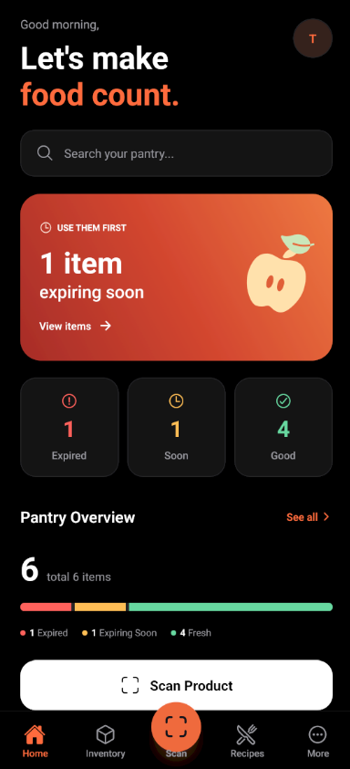
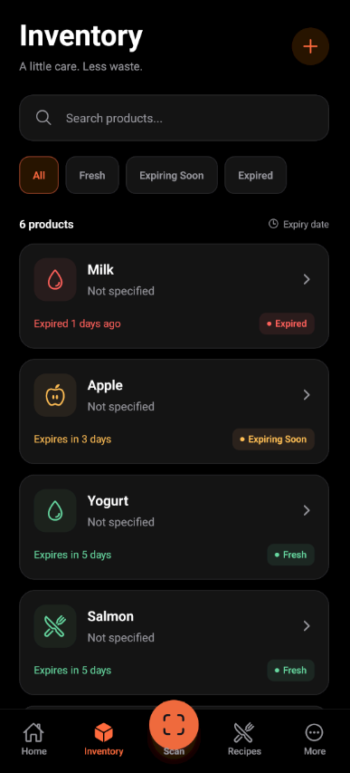
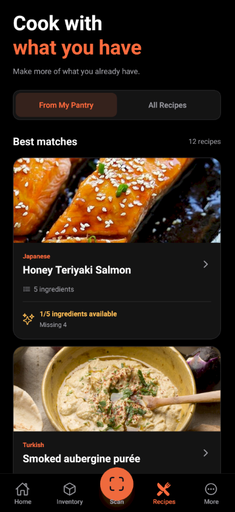

# SmartPantry

<p align="center">
  
</p>

<h3 align="center">Keep track. Waste less. Cook smarter.</h3>

<p align="center">
  Offline-first mobile pantry manager built with React Native, Expo, TypeScript, SQLite and Supabase.
</p>

<p align="center">
  
  
  
  
  
  
</p>

---

## About

**SmartPantry** is a mobile application for managing household food, tracking expiration dates, reducing food waste and discovering recipes based on ingredients already available at home.

The app is designed around an **offline-first architecture**. SQLite remains the main local runtime database, while Supabase provides authentication, cloud synchronization, private avatar storage and account-specific backend data.

SmartPantry was developed as a university project, but its architecture and feature set are designed to resemble a production mobile application.

---

## Features

### Pantry Management

- Add, edit and remove pantry products
- Automatic expiration status:
  - Fresh
  - Expiring Soon
  - Expired
- Quick Add presets
- Product details and notes
- Storage location tracking
- Quantity and unit management

### Barcode Scanner

- Barcode scanning using the device camera
- Manual barcode entry
- Product lookup through **Open Food Facts**
- Fallback product search by name
- Manual product creation when no result is found

### Recipes

- Recipe discovery powered by **TheMealDB**
- Recipe search and categories
- Detailed recipe view
- Pantry-to-recipe ingredient matching
- Available and missing ingredient calculation
- Match percentage
- Add missing ingredients directly to the Shopping List

### Shopping List

- Add, edit and delete items
- Mark items as purchased
- Separate To Buy / Purchased sections
- Clear purchased items
- Persistent local storage

### Product History & Statistics

Products can be marked as:

- Consumed
- Wasted

SmartPantry preserves product snapshots in history and provides statistics including:

- Consumed products
- Wasted products
- Total processed items
- Waste rate
- Most wasted categories
- Recent activity
- 7 Days / 30 Days / All Time filters

### Expiration Notifications

- Local expiration reminders
- Configurable reminder timing
- Automatic rescheduling after product edits
- Automatic cancellation after deletion, consumption or waste
- Notification reconciliation after cloud synchronization

### Authentication & Account Management

- Email/password authentication
- Google OAuth
- Email confirmation
- Persistent sessions
- Forgot password
- Reset password
- Change password
- Change email
- Profile editing
- Sign out
- Secure account deletion

### Profile & Avatars

- Display name
- Email
- Authentication provider
- Account creation date
- Custom profile photo
- Google avatar fallback
- Initials fallback
- Private avatar storage through Supabase Storage

### Offline-First Cloud Sync

SmartPantry remains fully usable without internet access.

Local changes are stored in SQLite first and synchronized with Supabase when connectivity is available.

Features include:

- Per-account local caches
- Initial local/cloud merge
- Last Write Wins conflict resolution
- Tombstones for deleted records
- Manual **Sync now**
- Automatic synchronization
- Offline and sync status
- Account isolation
- Remote expiration-notification reconciliation

### Localization

SmartPantry currently supports:

- English
- Slovak
- Russian
- Ukrainian
- Hungarian

### Appearance

- Light theme
- Dark theme
- System theme
- High Contrast mode
- Multiple accent colors
- Semantic status colors for fresh, expiring and expired products

---

## Screenshots

> Screenshots will be added from the Android release build.

<!--
Example structure:

<p align="center">
  
  
  
</p>

<p align="center">
  
  
</p>
-->

---

## Architecture

```mermaid
flowchart LR
    UI[React Native UI]

    SQLite[(SQLite)]
    Sync[Sync Layer]
    Postgres[(Supabase Postgres)]

    Auth[Supabase Auth]
    Storage[Supabase Storage]

    OFF[Open Food Facts]
    Meal[TheMealDB]

    UI --> SQLite

    SQLite <--> Sync
    Sync <--> Postgres

    UI --> Auth
    UI --> Storage

    UI --> OFF
    UI --> Meal
