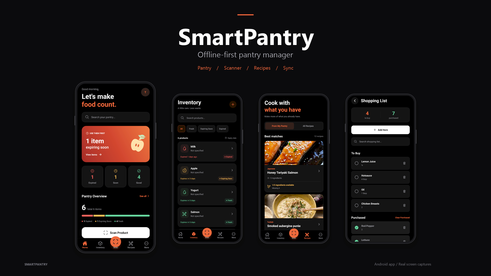

<div align="center">


# SmartPantry

### Keep track. Waste less. Cook smarter.

Offline-first mobile pantry manager for Android.

Track food, scan products, monitor expiration dates, discover recipes  
and keep your pantry synchronized across devices.

<br/>

[](https://github.com/NeroRebel/SmartPantry/releases/latest/download/SmartPantry.apk)

<br/>

<p align="center">
  
  
  
  
  
</p>

## 🎬 SmartPantry in Action

See the complete SmartPantry workflow in action — pantry tracking,
barcode scanning, recipes, shopping lists and statistics.




https://github.com/user-attachments/assets/0ae3dd25-a343-4550-8092-908a123bad0f

## 📚 Project Documentation

<p align="center">
  <b>Requirements • Architecture • Implementation • QA • Release</b>
</p>

| Document | Description |
| --- | --- |
| 📋 [SPEC.md](SPEC.md) | Requirements, users, scope, constraints and acceptance criteria |
| 🏗️ [DESIGN.md](DESIGN.md) | Architecture, data model, APIs, synchronization and technical decisions |
| 🧭 [project.md](project.md) | Initiative, epics, user stories, MVP and project scope |
| 🔐 [auth-setup.md](docs/auth-setup.md) | Authentication, OAuth and account management |
| ☁️ [cloud-sync.md](docs/cloud-sync.md) | Offline-first synchronization architecture |
| 🗃️ [data-handling.md](docs/data-handling.md) | Application data handling and persistence |
| ✨ [polish-qa.md](docs/polish-qa.md) | UI/UX audit, accessibility and QA |
| 🚀 [release-readiness.md](docs/release-readiness.md) | Android release preparation and validation |

</div>


## Development

Use Node.js 22.13+ (Node 24 recommended for the node:sqlite test harness), npm,
Java 17 and Android SDK 36 with NDK 27.1.12297006 for local Android builds.

```sh
npm ci
```

## Environment

Create `.env` based on `.env.example`.

Required variables:

```env
EXPO_PUBLIC_SUPABASE_URL=
EXPO_PUBLIC_SUPABASE_PUBLISHABLE_KEY=
```

Only the public Supabase URL and publishable key belong in the mobile environment.

Never place administrative or server-side Supabase credentials inside the application.

---

# Development Build

SmartPantry uses native Expo modules and should be tested with an **Expo Development Build**, not Expo Go.

### Build Android

```bash
npx expo run:android
```

### Start Metro

```bash
npx expo start --dev-client
```

---

# Android Release

Current release:

```text
SmartPantry 1.0.0
versionCode 1
package: com.nerorebel.smartpantry
```

Build:

```powershell
cd android
.\gradlew assembleRelease
```

Output:

```text
android/app/build/outputs/apk/release/app-release.apk
```

Release builds must be signed using the same production/upload keystore to remain upgrade-compatible.

---

# Project Structure

```text
SmartPantry/
│
├── assets/
│   └── images/
│
├── docs/
│
├── plugins/
│
├── scripts/
│
├── src/
│   ├── api/
│   ├── app/
│   ├── auth/
│   ├── components/
│   ├── constants/
│   ├── data/
│   ├── db/
│   ├── hooks/
│   ├── i18n/
│   ├── lib/
│   ├── services/
│   ├── sync/
│   ├── theme/
│   ├── types/
│   └── utils/
│
├── supabase/
│   └── functions/
│
├── tests/
│
├── app.json
├── package.json
└── project.md
```

# Security

SmartPantry follows several security principles:

- Passwords are managed by Supabase Auth
- SmartPantry never stores passwords
- The mobile application contains only the Supabase publishable key
- Service-role credentials remain server-side
- Row Level Security protects cloud records
- Storage policies protect avatars
- Account deletion runs through a server-side Edge Function
- `.env` files are excluded from Git
- Android keystores are excluded from Git
- APK/AAB build artifacts are excluded from Git

---

# External Services

### Open Food Facts

Used for:

- Barcode product lookup
- Product-name fallback search

Product availability depends on the Open Food Facts community database and may vary by country or product.

### TheMealDB

Used for:

- Recipe discovery
- Recipe search
- Categories
- Recipe details

### Supabase

Used for:

- Authentication
- PostgreSQL cloud storage
- Avatar storage
- Edge Functions
- Offline-first synchronization backend

---

# Project Status

### SmartPantry v1.0.0

| Feature | Status |
|---|:---:|
| Inventory | ✅ |
| Barcode Scanner | ✅ |
| Open Food Facts | ✅ |
| Recipes | ✅ |
| Pantry Matching | ✅ |
| Shopping List | ✅ |
| Product History | ✅ |
| Statistics | ✅ |
| Notifications | ✅ |
| Google Authentication | ✅ |
| Email Authentication | ✅ |
| Profile | ✅ |
| Avatar Upload | ✅ |
| Password Management | ✅ |
| Change Email | ✅ |
| Delete Account | ✅ |
| Offline Mode | ✅ |
| Cloud Sync | ✅ |
| Account Isolation | ✅ |
| Localization | ✅ |
| Themes | ✅ |
| Android Release | ✅ |

---

# Testing

The project includes automated tests covering major application logic including:

- Authentication
- Avatar handling
- Notifications
- Products
- Recipes
- Cloud synchronization
- Account isolation
- UI polish
- Release configuration

Release preparation completed with:

```text
TypeScript     ✅
Lint           ✅
Tests          ✅
Android Build  ✅
Signed APK     ✅
```

---

# Known Limitations

- Synchronization currently uses whole-row Last Write Wins conflict resolution.
- Device clock differences may influence synchronization conflict resolution.
- Simultaneous offline lifecycle actions on multiple devices may create duplicate history events.
- Open Food Facts does not contain every commercial product.
- Recipe ingredient matching currently uses lightweight normalization rather than advanced NLP.
- iOS has not yet received the same level of physical-device testing as Android.

---

# Future Improvements

Potential future development:

- 🤖 AI-generated recipes
- 🥗 Nutrition information
- ❤️ Favorite recipes
- 🧠 Improved ingredient matching
- 📊 Advanced analytics
- 👋 User onboarding
- 🔄 Advanced synchronization conflict handling
- 🍎 Full iOS release

---

# License

This project is licensed under the **MIT License**.

See [`LICENSE`](LICENSE) for details.

---

<div align="center">


### SmartPantry

**Keep track. Waste less. Cook smarter.**

<br/>

[](https://github.com/NeroRebel/SmartPantry/releases/latest/download/SmartPantry.apk)

</div>
