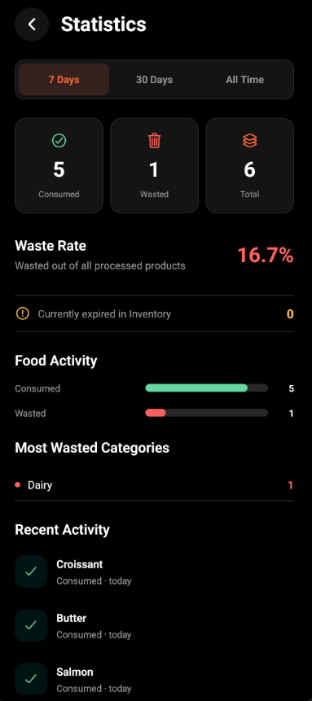
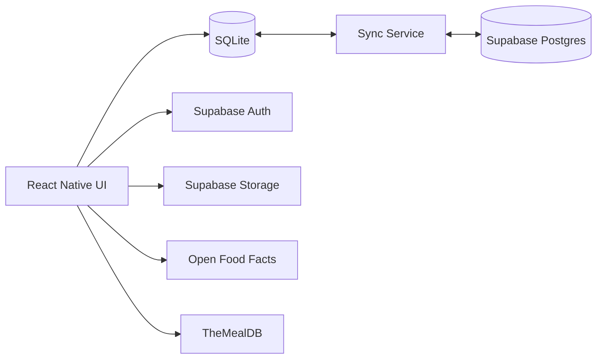

<div align="center">


# SmartPantry

### Keep track. Waste less. Cook smarter.

**Offline-first mobile pantry manager for Android**

Track food, scan products, monitor expiration dates, discover recipes  
and keep your pantry synchronized across devices.

<br/>

[](https://reactnative.dev/)
[](https://expo.dev/)
[](https://www.typescriptlang.org/)
[](https://supabase.com/)
[](https://www.sqlite.org/)
[](https://www.android.com/)

<br/>

[](https://github.com/NeroRebel/SmartPantry/releases/latest/download/SmartPantry.apk)

**Android · Version 1.0.0**

[Latest Release](https://github.com/NeroRebel/SmartPantry/releases/latest)
·
[Architecture](#architecture)
·
[Documentation](#documentation)

</div>

---

## About

**SmartPantry** is a mobile application for managing household food and reducing food waste.

It allows users to track pantry products, monitor expiration dates, scan barcodes, discover recipes based on ingredients they already have, maintain a shopping list, and analyze consumed or wasted food.

The application follows an **offline-first architecture**:

- **SQLite** is the primary runtime database.
- The application remains usable without an internet connection.
- **Supabase** provides authentication, secure cloud synchronization, profile storage, avatar storage, and backend services.
- Local changes are synchronized when a connection becomes available.

SmartPantry was developed as a university project, but its architecture and feature set are designed to resemble a production mobile application.

---

## Download

<div align="center">

### Android

[](https://github.com/NeroRebel/SmartPantry/releases/latest/download/SmartPantry.apk)

The latest signed Android APK is available through **GitHub Releases**.

</div>

> Android may ask you to allow installation from unknown sources when installing an APK outside Google Play.

---

## Screenshots

> Add release screenshots to `docs/screenshots/` and enable the block below.

<!--
<p align="center">
  
  
  
</p>

<p align="center">
  
  
  
</p>
-->

---

# Features

## Pantry Management

- Add, edit, and remove products
- Track quantity and units
- Store expiration dates
- Assign storage locations
- Add notes and product information
- Quick Add product presets
- Automatic expiration status:
  - 🟢 Fresh
  - 🟠 Expiring Soon
  - 🔴 Expired

## Barcode Scanner

SmartPantry includes a native barcode scanner powered by **Expo Camera**.

- Camera barcode scanning
- Manual barcode entry
- Product lookup through **Open Food Facts**
- Fallback product search by name
- Manual product creation
- Original scanned barcode preservation

If Open Food Facts does not contain the scanned product, SmartPantry allows the user to search for a similar product or create it manually.

## Recipes

Recipes are provided through **TheMealDB**.

- Recipe discovery
- Search
- Categories
- Recipe details
- Ingredients and instructions
- Pantry-based recipe matching
- Missing ingredient detection
- Match percentage calculation
- Add missing ingredients directly to the Shopping List

### From My Pantry

```text
Pantry
   ↓
Ingredient normalization
   ↓
Recipe matching
   ↓
Available / Missing ingredients
   ↓
Match percentage
```

## Shopping List

- Add items
- Edit items
- Delete items
- Mark products as purchased
- Separate **To Buy** and **Purchased** sections
- Clear purchased items
- Add missing recipe ingredients
- Offline persistence
- Cloud synchronization

## Product History

Products can be marked as:

- **Consumed**
- **Wasted**

Instead of losing the information, SmartPantry stores a snapshot of the product in history.

## Statistics

SmartPantry provides insight into food usage and waste:

- Consumed products
- Wasted products
- Total processed products
- Waste rate
- Most wasted categories
- Recent activity
- 7 Days / 30 Days / All Time filters

## Expiration Notifications

- Configurable reminder timing
- Automatic scheduling
- Rescheduling after expiration-date changes
- Cancellation after deletion
- Cancellation after consumption or waste
- Notification reconciliation after cloud synchronization

No remote push infrastructure is required.

---

# Authentication & Accounts

Authentication is provided by **Supabase Auth**.

Supported functionality:

- Email/password registration
- Email confirmation
- Email/password sign in
- Google OAuth
- Persistent sessions
- Forgot Password
- Reset Password
- Change Password
- Change Email
- Sign Out
- Secure Delete Account

Google-only accounts automatically hide password-management functionality where it is not applicable.

---

## Profile

Users can manage:

- Display name
- Email
- Authentication provider
- Account creation date
- Profile avatar
- Password
- Email address
- Cloud synchronization
- Account deletion

The profile can be opened directly from the avatar on the Home screen or through More.

## Avatar Storage

Custom avatars are stored in a private **Supabase Storage** bucket.

```text
Custom SmartPantry avatar
        ↓
Google avatar
        ↓
Initials fallback
```

Storage access is protected by user-specific policies.

---

# Offline-First Cloud Sync

One of the core architectural features of SmartPantry is offline-first synchronization.

```text
                   ┌─────────────────────┐
                   │     SmartPantry     │
                   │  React Native UI    │
                   └──────────┬──────────┘
                              │
                              ▼
                       ┌────────────┐
                       │   SQLite   │
                       │ Local DB   │
                       └─────┬──────┘
                             │
                             │ Sync
                             ▼
                    ┌─────────────────┐
                    │   Sync Service  │
                    └────────┬────────┘
                             │
                             ▼
                  ┌────────────────────┐
                  │ Supabase Postgres  │
                  │    Cloud Data      │
                  └────────────────────┘
```

SQLite remains the primary runtime database.

Local CRUD operations **never wait for Supabase**.

### Synchronization features

- Initial local/cloud merge
- Per-account local caches
- Local user ownership
- Automatic synchronization
- Manual **Sync now**
- Offline mode
- Sync status
- Tombstones for deleted records
- Account isolation
- Notification reconciliation
- Retry handling

### Conflict Resolution

The current synchronization strategy uses **Last Write Wins** based on `updated_at`.

```text
Local newer  → upload local version
Remote newer → apply remote version
Same version → no change
```

Deleted records use `deleted_at` tombstones to prevent deleted data from being recreated by another device.

---

# Architecture

<div align="center">

[](https://gitdiagram.com/nerorebel/smartpantry)

**Click the diagram to explore the project architecture**

</div>

### High-level architecture



The application does not depend on Supabase for normal pantry operations.

Cloud synchronization happens independently of local CRUD.

---

# Tech Stack

| Area | Technology |
|---|---|
| Mobile | React Native |
| Framework | Expo |
| Language | TypeScript |
| Navigation | Expo Router |
| Local Database | Expo SQLite |
| Backend | Supabase |
| Authentication | Supabase Auth |
| Cloud Database | Supabase Postgres |
| File Storage | Supabase Storage |
| Barcode Scanning | Expo Camera |
| Notifications | Expo Notifications |
| Image Selection | Expo Image Picker |
| Product Database | Open Food Facts |
| Recipes | TheMealDB |
| Localization | Expo Localization + custom i18n |
| Version Control | Git / GitHub |

---

# Cloud Backend

Supabase currently manages:

```text
auth.users

profiles
products
shopping_list
product_history

Storage
└── avatars/

Edge Functions
└── delete-account
```

All user-owned database tables are protected using **Row Level Security (RLS)**.

Authenticated users can only access records belonging to their own account.

## Secure Account Deletion

Account deletion is handled through a server-side Supabase Edge Function.

```text
Authentication account
        ↓
Profile
        ↓
Products
        ↓
Shopping List
        ↓
Product History
        ↓
Avatar files
        ↓
Local SQLite account cache
        ↓
Local notifications
```

Other users' local caches and cloud data are not affected.

---

# Localization

SmartPantry supports five languages:

| Language | Code |
|---|---|
| 🇬🇧 English | `en` |
| 🇸🇰 Slovak | `sk` |
| 🇷🇺 Russian | `ru` |
| 🇺🇦 Ukrainian | `uk` |
| 🇭🇺 Hungarian | `hu` |

External recipe content is displayed in the language supplied by the external API.

---

# Appearance

SmartPantry supports:

- Dark theme
- Light theme
- System theme
- High Contrast mode

Accent colors:

- Orange
- Purple
- Green
- Red
- Yellow

Semantic colors remain independent from the selected accent:

```text
Fresh         → Green
Expiring Soon → Orange / Yellow
Expired       → Red
```

---

# Development

## Requirements

```text
Node.js 22.13+
npm
Java 17
Android SDK 36
Android NDK 27.1.12297006
```

### Clone

```bash
git clone https://github.com/NeroRebel/SmartPantry.git
cd SmartPantry
```

### Install dependencies

```bash
npm ci
```

## Environment

Create `.env` based on `.env.example`.

Required variables:

```env
EXPO_PUBLIC_SUPABASE_URL=
EXPO_PUBLIC_SUPABASE_PUBLISHABLE_KEY=
```

Only the public Supabase URL and publishable key belong in the mobile environment.

Never place administrative or server-side Supabase credentials inside the application.

---

# Development Build

SmartPantry uses native Expo modules and should be tested with an **Expo Development Build**, not Expo Go.

### Build Android

```bash
npx expo run:android
```

### Start Metro

```bash
npx expo start --dev-client
```

---

# Android Release

Current release:

```text
SmartPantry 1.0.0
versionCode 1
package: com.nerorebel.smartpantry
```

Build:

```powershell
cd android
.\gradlew assembleRelease
```

Output:

```text
android/app/build/outputs/apk/release/app-release.apk
```

Release builds must be signed using the same production/upload keystore to remain upgrade-compatible.

---

# Project Structure

```text
SmartPantry/
│
├── assets/
│   └── images/
│
├── docs/
│
├── plugins/
│
├── scripts/
│
├── src/
│   ├── api/
│   ├── app/
│   ├── auth/
│   ├── components/
│   ├── constants/
│   ├── data/
│   ├── db/
│   ├── hooks/
│   ├── i18n/
│   ├── lib/
│   ├── services/
│   ├── sync/
│   ├── theme/
│   ├── types/
│   └── utils/
│
├── supabase/
│   └── functions/
│
├── tests/
│
├── app.json
├── package.json
└── project.md
```

---

# Documentation

| Document | Description |
|---|---|
| [`auth-setup.md`](docs/auth-setup.md) | Authentication, OAuth and account management |
| [`cloud-sync.md`](docs/cloud-sync.md) | Offline-first synchronization architecture |
| [`data-handling.md`](docs/data-handling.md) | Application data handling |
| [`polish-qa.md`](docs/polish-qa.md) | UI/UX audit and QA |
| [`release-readiness.md`](docs/release-readiness.md) | Android release preparation |

---

# Security

SmartPantry follows several security principles:

- Passwords are managed by Supabase Auth
- SmartPantry never stores passwords
- The mobile application contains only the Supabase publishable key
- Service-role credentials remain server-side
- Row Level Security protects cloud records
- Storage policies protect avatars
- Account deletion runs through a server-side Edge Function
- `.env` files are excluded from Git
- Android keystores are excluded from Git
- APK/AAB build artifacts are excluded from Git

---

# External Services

### Open Food Facts

Used for:

- Barcode product lookup
- Product-name fallback search

Product availability depends on the Open Food Facts community database and may vary by country or product.

### TheMealDB

Used for:

- Recipe discovery
- Recipe search
- Categories
- Recipe details

### Supabase

Used for:

- Authentication
- PostgreSQL cloud storage
- Avatar storage
- Edge Functions
- Offline-first synchronization backend

---

# Project Status

### SmartPantry v1.0.0

| Feature | Status |
|---|:---:|
| Inventory | ✅ |
| Barcode Scanner | ✅ |
| Open Food Facts | ✅ |
| Recipes | ✅ |
| Pantry Matching | ✅ |
| Shopping List | ✅ |
| Product History | ✅ |
| Statistics | ✅ |
| Notifications | ✅ |
| Google Authentication | ✅ |
| Email Authentication | ✅ |
| Profile | ✅ |
| Avatar Upload | ✅ |
| Password Management | ✅ |
| Change Email | ✅ |
| Delete Account | ✅ |
| Offline Mode | ✅ |
| Cloud Sync | ✅ |
| Account Isolation | ✅ |
| Localization | ✅ |
| Themes | ✅ |
| Android Release | ✅ |

---

# Testing

The project includes automated tests covering major application logic including:

- Authentication
- Avatar handling
- Notifications
- Products
- Recipes
- Cloud synchronization
- Account isolation
- UI polish
- Release configuration

Release preparation completed with:

```text
TypeScript     ✅
Lint           ✅
Tests          ✅
Android Build  ✅
Signed APK     ✅
```

---

# Known Limitations

- Synchronization currently uses whole-row Last Write Wins conflict resolution.
- Device clock differences may influence synchronization conflict resolution.
- Simultaneous offline lifecycle actions on multiple devices may create duplicate history events.
- Open Food Facts does not contain every commercial product.
- Recipe ingredient matching currently uses lightweight normalization rather than advanced NLP.
- iOS has not yet received the same level of physical-device testing as Android.

---

# Future Improvements

Potential future development:

- 🤖 AI-generated recipes
- 🥗 Nutrition information
- ❤️ Favorite recipes
- 🧠 Improved ingredient matching
- 📊 Advanced analytics
- 👋 User onboarding
- 🔄 Advanced synchronization conflict handling
- 🍎 Full iOS release

---

# License

This project is licensed under the **MIT License**.

See [`LICENSE`](LICENSE) for details.

---

<div align="center">


### SmartPantry

**Keep track. Waste less. Cook smarter.**

<br/>

[](https://github.com/NeroRebel/SmartPantry/releases/latest/download/SmartPantry.apk)

</div>
